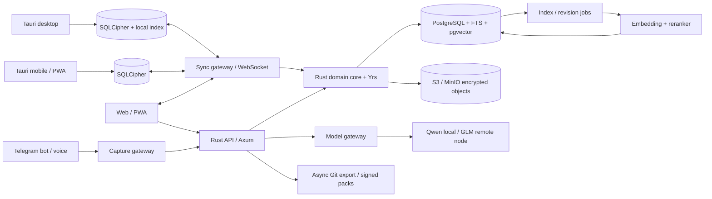

# Obsidian на стероидах: командная память с Markdown, правами и локальным ИИ

## Короткий вывод

Идея жизнеспособна, но её сильная версия — не «ещё один Obsidian/Notion». Рынок универсальных заметочников уже плотный. Перспективный продукт здесь — **операционная память конкретной команды или профессии**: быстрый сбор сырья из любых каналов, превращение его в проверенные инструкции, разграничение доступа, ответы ИИ только по разрешённым данным и выпуск платных версионируемых «пакетов знаний».

Рекомендуемая конструкция:

- Markdown остаётся переносимым каноническим представлением страниц; служебные данные, права, связи, ревизии и «базы» хранятся отдельно в PostgreSQL.
- Основной сервер и синхронизационный слой пишутся на Rust: Axum/Tokio, SQLx, Yrs (Rust-реализация протокола Yjs). Фронтенд — React/TypeScript, визуальный Markdown-редактор Milkdown и режим raw Markdown на CodeMirror.
- Синхронизация в первой версии **local-first, но server-mediated**: клиенты работают из локального зашифрованного SQLite, CRDT сводит параллельные правки, сервер проверяет права на каждую подписку и запись. Полный P2P не нужен для MVP.
- Серверная база — PostgreSQL с полнотекстовым поиском и pgvector. Qdrant стоит добавлять только после фактического упора в масштаб или сложную фильтрацию. Файлы — S3/MinIO, локальные клиентские базы — SQLCipher.
- Git используется как экспорт, резервная копия и аудит публикаций, а не как рабочая БД и транспорт синхронизации.
- Для локального RAG разумная базовая связка — Qwen3-Embedding-0.6B + опциональный reranker + Qwen3.8-27B для ответа. GLM-5.3-Flash заметно сильнее как большой агентный/мультимодальный движок, но при 321 млрд общих параметров это серверная multi-GPU модель, а не обычная локальная модель рабочего компьютера.<sup>[17](https://huggingface.co/Qwen/Qwen3.8-27B/tree/main) [18](https://qwen.ai/blog?id=qwen3.8-flash-next) [19](https://huggingface.co/zai-org/GLM-5.3-Flash)</sup>
- Для первого продаваемого результата лучше не начинать с мобильных приложений, P2P и «маркетплейса». Сначала — web/PWA, desktop, Telegram capture, пространства/группы, Markdown, гибридный поиск, AI с цитатами и внутренний dogfood.

Главный архитектурный выбор — режим доверия. Если ваш self-hosted сервер считается доверенным, можно зашифровать диски, БД, бэкапы и объекты «на покое», а поиск и ИИ выполнять на сервере. Если требуется настоящее E2EE, сервер не может индексировать или осмыслять содержимое: поиск, embeddings и LLM придётся выполнять на клиенте либо на отдельном доверенном AI-узле, которому участник явно передал ключи. Обещать одновременно «zero-knowledge сервер» и «серверный RAG по расшифрованным данным» нельзя.

## Продуктовая формулировка

### Что именно строится

Рабочее определение продукта:

> Локально управляемая командная база знаний, где Markdown-страницы, голосовые заметки, файлы и структурированные записи собираются в приватные пространства; люди и ИИ превращают сырьё в проверенные инструкции; права действуют одинаково в интерфейсе, поиске, API и ответах ассистента; выбранные материалы публикуются как версионируемые пакеты.

Это решает четыре разные задачи одним контуром:

1. **Capture.** Быстро бросить мысль, ссылку, голосовое, файл или пересланное сообщение из web, desktop, mobile/PWA и Telegram.
2. **Sensemaking.** Расшифровать, связать с существующими заметками, найти противоречия и предложить структуру.
3. **Knowledge operations.** Назначить владельца, статус, срок пересмотра и права; превратить черновик в рабочий регламент.
4. **Distribution.** Выдать материал своей группе, клиенту или покупателю как конкретную версию с changelog и условиями лицензии.

Без пунктов 2–4 продукт останется красивым хранилищем. За хранилище уже конкурируют Obsidian, Logseq, Notion и десятки self-hosted решений. Ценность и потенциальный moat находятся в накопленном отраслевом материале, его качестве, workflow публикации и permission-aware ИИ.

### Базовый жизненный цикл знания

Каждая единица проходит понятные состояния:

`Inbox → Draft → Reviewed → Verified → Published → Superseded/Archived`

Минимальные поля страницы:

- стабильный UUID;
- пространство и путь;
- заголовок, теги и тип;
- автор и текущий владелец;
- статус доверия;
- дата последней проверки и `review_due_at`;
- ссылки на источники;
- версия и ссылка на заменивший материал;
- класс видимости;
- хэш содержимого и версия embedding-модели.

Так ИИ сможет отвечать не просто по «похожему тексту», а предпочитать проверенную, свежую и применимую инструкцию. Он также сможет честно сказать: «в базе два противоречащих правила» или «этот мануал не пересматривался восемь месяцев».

## Что уже существует

### Сравнительная матрица

| Проект | Что совпадает с идеей | Что не совпадает | Практический вывод |
|---|---|---|---|
| **Docmost** | Зрелая self-hosted командная wiki: совместное редактирование, пространства, группы, история, вложения; появились локальные модели через Ollama, AI Answers, REST API и MCP.<sup>[1](https://github.com/Docmost/docmost) [4](https://docmost.com/docs/user-guide)</sup> | React + NestJS/TypeScript, а не Rust; это rich/block wiki, не local-first Markdown vault. Page-level permissions, базы, AI/API/MCP и SSO относятся к коммерческим функциям.<sup>[2](https://docmost.com/docs/self-hosting/development) [3](https://docmost.com/docs/user-guide/pages/page-permissions) [5](https://docmost.com/docs/user-guide/bases)</sup> | Лучший быстрый полигон для проверки workflow команды. Плохое основание, если Rust, Markdown-first и собственная модель синхронизации — жёсткие требования. |
| **tela** | Почти точное функциональное попадание: canonical Markdown, Go + PostgreSQL, React/Milkdown, Yjs, FTS + pgvector, Ollama embedder, WebDAV и встроенный MCP.<sup>[6](https://github.com/zcag/tela)</sup> | Go, не Rust; server-first; нет заявленного E2EE. На 12.09.2026 проект очень молодой — 61 GitHub star и 5 forks; AGPL/open-core.<sup>[6](https://github.com/zcag/tela)</sup> | Самый полезный blueprint. Развернуть и прогнать собственный corpus; код изучать как референс. Форкать только если Go и AGPL приемлемы. |
| **AppFlowy** | Большое сообщество, Rust-ядро, Flutter-клиенты, desktop/mobile, self-hosting, collaboration и AI.<sup>[7](https://github.com/AppFlowy-IO/AppFlowy)</sup> | Продукт объектно-блочный, не Markdown-native; архитектура и кодовая база намного шире нужного; AGPL. | Сильный источник решений по Rust-мультиплатформенности и collaborative data, но дорогой фундамент для узкого Markdown-продукта. |
| **AFFiNE / OctoBase** | OctoBase — Rust, local-first CRDT, embedded/server режимы, structured/unstructured data и заявленная permission model.<sup>[8](https://github.com/toeverything/OctoBase)</sup> | Сам OctoBase прямо помечает большинство компонентов как неготовые к production; AFFiNE ориентирован на blocks/whiteboard, не на Markdown; AGPL.<sup>[8](https://github.com/toeverything/OctoBase)</sup> | Следить и прототипировать отдельно. Не ставить в критический путь MVP. |
| **Anytype / any-sync** | Наиболее законченная идея local-first + P2P + E2EE: зашифрованные DAG/CRDT-каналы, offline, отдельные sync/file/consensus nodes.<sup>[9](https://github.com/anyproto/any-sync)</sup> | Go-стек, высокая протокольная сложность, block/object model вместо Markdown. Desktop-клиент распространяется по Any Source Available License, ограничивающей коммерческое использование вне разрешённых сетей.<sup>[10](https://github.com/anyproto/anytype-ts/blob/develop/LICENSE.md)</sup> | Отличный референс для будущих sealed spaces, но не копировать архитектуру целиком в первую версию. |
| **SilverBullet** | Markdown-файлы, self-hosted browser UI, backlinks, objects/queries, Go backend и MIT.<sup>[11](https://github.com/silverbulletmd/silverbullet)</sup> | Personal knowledge management: нет требуемой командной permission/governance модели и AI-контура. | Хороший референс «Markdown как данные» и расширяемости; не готовая командная платформа. |
| **Outline** | Отполированная UX командной базы, real-time, permissions, self-hosting.<sup>[12](https://github.com/outline/outline)</sup> | Node/React, server-first, не Markdown-vault; BSL 1.1. | UX benchmark, но не технический фундамент. |

### Что даёт Docmost уже сегодня

Docmost не следует списывать. Проект уже закрывает подавляющее большинство «корпоративной wiki»: пространства, группы, совместное редактирование, комментарии, историю, вложения и импорт/экспорт. Его актуальная документация также описывает local LLM через Ollama, AI search, REST API и MCP.<sup>[1](https://github.com/Docmost/docmost) [4](https://docmost.com/docs/user-guide) [20](https://docmost.com/docs/self-hosting/ai/ai-search)</sup>

Но найдено три стратегических несоответствия:

- код — monorepo на React/NestJS/TypeScript с PostgreSQL и Redis;<sup>[2](https://docmost.com/docs/self-hosting/development)</sup>
- Markdown в нём является форматом импорта/экспорта, а не локальным переносимым хранилищем;
- именно те функции, которые образуют коммерческое ядро вашей идеи — детальные page permissions, Bases, AI/API/MCP, SSO — помещены в коммерческую редакцию.<sup>[3](https://docmost.com/docs/user-guide/pages/page-permissions) [5](https://docmost.com/docs/user-guide/bases) [20](https://docmost.com/docs/self-hosting/ai/ai-search)</sup>

Вывод: **развернуть Docmost полезно как UX/процессный эксперимент на 2–3 недели**, но переписывать его backend на Rust — почти то же самое, что создать продукт заново, только с постоянной борьбой против исходной архитектуры.

### Неожиданно близкий проект: tela

tela уже реализует схему `pages.body TEXT` как canonical Markdown, Milkdown + Yjs для multiplayer, PostgreSQL FTS, pgvector chunks, Qwen3-Embedding-0.6B через Ollama и MCP в основном backend.<sup>[6](https://github.com/zcag/tela) [13](https://github.com/zcag/tela/blob/main/docs/architecture.md)</sup> Это важная проверка, что предложенная композиция не только теоретическая.

При этом зрелость проекта пока недостаточна, чтобы безусловно ставить на него бизнес: маленькое сообщество, нет заявленного E2EE, backend на Go, а лицензия AGPL требует раскрывать соответствующий исходный код модифицированной сетевой версии. Возможна отдельная коммерческая лицензия от автора.<sup>[6](https://github.com/zcag/tela)</sup>

Рациональный ход — сделать tela первым конкурентным стендом: загрузить 500–2 000 реальных заметок, проверить русский поиск, одновременное редактирование, экспорт, MCP и ответы на ваши рабочие вопросы. То, что не выдержит практику, станет списком требований к собственному продукту.

## Три архитектурных пути

### A. Форк Docmost или tela

**Плюсы:** самый быстрый путь к интерфейсу, пользователям и реальному corpus; много скучных функций уже есть.

**Минусы:** фундамент не Rust, local-first/E2EE придётся пристраивать к server-first модели; AGPL влияет на закрытую коммерческую разработку; у Docmost нужные функции частично enterprise-only, у tela — риск зрелости.

**Когда выбирать:** если первичная цель — начать пользоваться продуктом за недели и продавать контент, а не платформу.

### B. Собственный Rust core, централизованная координация, local-first клиенты

**Плюсы:** Markdown и security model проектируются правильно с первого дня; единый Rust domain core можно использовать на сервере, в Tauri и для CLI; сервер остаётся точкой прав, аудита и публикации, а CRDT даёт offline и параллельную работу.

**Минусы:** дороже MVP; синхронизация, редактор и миграции формата — рискованные зоны.

**Когда выбирать:** если продукт и кодовая база сами являются активом, а не только оболочкой для собственных мануалов.

### C. Полный P2P/E2EE с «тупым» сервером

**Плюсы:** максимальная приватность, автономность и независимость от сервера.

**Минусы:** сложные ключи групп, отзыв доступа, восстановление аккаунта, мобильная синхронизация, публичные страницы, Telegram bot и AI. Серверный semantic search невозможен без раскрытия данных доверенному вычислителю. Anytype показывает, что это отдельная инфраструктурная компания, а не дополнительная галочка.<sup>[9](https://github.com/anyproto/any-sync)</sup>

**Когда выбирать:** если zero-knowledge — главный продающий тезис и команда готова пожертвовать скоростью выхода.

### Рекомендация

Выбирать **B**, но начать с короткого пилота A. То есть не форкать продукт навсегда, а за 2–3 недели выяснить реальное поведение пользователей на Docmost/tela. Затем строить Rust-систему с server-mediated sync. E2EE оставить как отдельный класс пространств после стабилизации data model.

## Рекомендуемая архитектура



### Границы компонентов

1. **Domain core (Rust library).** Типы `Workspace`, `Space`, `Page`, `Revision`, `Base`, `Record`, `Grant`, `Pack`; проверка переходов статуса, permission decisions, Markdown parsing и экспорт.
2. **Server (Rust binary).** REST/JSON или Connect/gRPC API, WebSocket sync, auth, audit, jobs. Axum поддерживает WebSocket из коробки, SQLx даёт асинхронный PostgreSQL/SQLite и compile-time проверяемые SQL-запросы.<sup>[21](https://docs.rs/axum/latest/axum/extract/ws/) [22](https://docs.rs/sqlx/latest/sqlx/macro.query.html)</sup>
3. **Web frontend.** React/TypeScript, Milkdown как основной WYSIWYG Markdown editor, CodeMirror как raw-режим. Milkdown основан на ProseMirror и имеет Yjs-интеграцию; CodeMirror предоставляет базу для больших документов и collaborative editing.<sup>[23](https://github.com/Milkdown/milkdown) [24](https://codemirror.net/examples/collab/)</sup>
4. **Desktop/mobile shell.** Tauri 2 позволяет использовать общий web frontend на desktop и mobile, а чувствительную логику, filesystem, keychain и local DB держать в Rust.<sup>[25](https://v2.tauri.app/start/)</sup>
5. **AI workers.** Не встраивать CUDA inference в Rust core. Общаться с Ollama/vLLM/SGLang/llama.cpp и облачными провайдерами через versioned OpenAI-compatible model gateway.
6. **Capture adapters.** Telegram, web clipper, email/drop-folder в будущем. Они создают immutable inbox items; преобразование в каноническую страницу проходит через preview/diff и подтверждение.

## Markdown и «БД как таковая»

### Каноническая страница

Содержимое страницы хранится как UTF-8 Markdown с ограниченным и документированным dialect: CommonMark + GFM tables/task lists + wikilinks + callouts + Mermaid + математические блоки. Неизвестные HTML/директивы должны сохраняться losslessly, даже если UI не умеет их красиво редактировать.

Пример переносимого экспорта:

```markdown
---
id: 0199a6f7-...
title: Проверка поставщика
type: procedure
tags: [закупки, проверка]
status: verified
owner: user:flags
review_due_at: 2026-12-01
---

# Проверка поставщика

...
```

При этом **права из frontmatter не являются источником истины**: иначе пользователь сможет изменить ACL обычным редактированием файла. Источник истины для grants — серверная БД; в Git-export права попадают в подписанный manifest.

### Почему нельзя сделать Git рабочей базой

Git превосходен как:

- переносимый архив Markdown;
- человекочитаемая история публикаций;
- доставка версионируемых paid packs;
- disaster recovery и внешний review через pull request.

Но как online database он плохо подходит для:

- быстрых мобильных и Telegram-записей;
- granularity прав на страницу/поле;
- real-time CRDT и presence;
- больших вложений;
- транзакций «страница + ACL + индекс + audit»;
- немедленного отзыва доступа;
- эффективного semantic search.

Поэтому Git-mirror должен быть **асинхронной проекцией**: сервер создаёт commit для опубликованной ревизии или по расписанию. Обратный импорт из Git делается через отдельный review queue, а не прямым overwrite.

### Структурированные данные

«Базы» стоит реализовать не как Excel внутри Markdown, а как тот же object model с typed properties:

- `base_schemas`: поля `text`, `long_text`, `number`, `date`, `select`, `multi_select`, `person`, `relation`, `file`, `formula` позже;
- `records`: UUID, schema, JSONB values, lifecycle status, ACL scope;
- `views`: columns, filters, sort, grouping, layout (`table`, затем `kanban`, позже `calendar`);
- `page_links`: relation/backlink graph;
- экспорт record → Markdown + YAML frontmatter; импорт обратно через schema validation.

На первом этапе достаточно таблицы, фильтров, сортировки и relations. Формулы, rollups и arbitrary scripting резко расширяют поверхность ошибок и безопасности.

## Синхронизация и CRDT

### Yjs/Yrs или Loro

| Вариант | Сильные стороны | Ограничения | Выбор |
|---|---|---|---|
| **Yjs + Yrs** | Огромная JS/editor ecosystem; Yrs стремится сохранять поведение и binary protocol Yjs, предоставляет Rust/WASM/FFI; поддерживает text, maps, arrays, XML, snapshots и awareness.<sup>[14](https://github.com/y-crdt/y-crdt)</sup> | Модель истории и application-level schema требуют аккуратного дизайна; серверная авторизация не является задачей CRDT. | **MVP recommendation** для React/Milkdown/CodeMirror + Rust server. |
| **Loro** | Rust/JS/Swift, rich text, movable tree/list, versioning/time travel, JSON-like structures, delta sync.<sup>[15](https://github.com/loro-dev/loro)</sup> | Меньше готовых editor bindings и production references; authorization также внешняя. Сами рекомендации Loro предупреждают, что write-time authorization библиотека не решает.<sup>[16](https://github.com/loro-dev/loro/blob/main/skills/loro/references/fit-and-architecture.md)</sup> | Хороший кандидат, если «Bases» и деревья становятся важнее совместимого редактора. Провести отдельный spike. |

CRDT — это механизм сведения конкурентных операций, **не security boundary**. Сервер обязан:

- проверить право чтения до подписки на document channel;
- проверить право записи для каждого update;
- ограничивать размер/frequency update;
- хранить actor/device/time и audit event;
- отключать активные соединения при отзыве прав;
- периодически compact updates в snapshot;
- валидировать, что итоговый Markdown парсится и не превышает лимиты.

### Local-first без полного P2P

Каждый нативный клиент хранит разрешённый рабочий набор в локальном SQLCipher: metadata, latest Markdown snapshot, CRDT state/update log, attachment cache и локальный FTS. SQLCipher добавляет AES-256 encryption для SQLite; Rust-binding rusqlite поддерживает bundled SQLCipher сборку.<sup>[26](https://github.com/sqlcipher/sqlcipher) [27](https://github.com/rusqlite/rusqlite)</sup>

Последовательность:

1. Пользователь меняет локальный CRDT-документ — UI отвечает мгновенно.
2. Update записывается локально с device sequence и отправляется серверу.
3. Сервер повторно проверяет ACL, дедуплицирует update, сохраняет event и транслирует другим разрешённым клиентам.
4. Worker строит canonical Markdown snapshot и новую revision.
5. Индексация срабатывает только при изменении content hash.

Это даёт offline и устранение конфликтов без маршрутизации NAT, relay nodes, distributed membership и восстановления P2P-сети.

## Права и безопасность

### Модель доступа

Минимальная и понятная иерархия:

- `workspace` — tenant и административная граница;
- `space` — основная граница доступа и ключа;
- `page/base` — опциональное сужение прав;
- `group` и direct grants;
- роли `owner`, `editor`, `commenter`, `viewer`;
- отдельные service accounts для Telegram, AI и MCP с tool scopes.

В MVP лучше не делать произвольные deny-правила. Наследование `workspace → space → page` и явное restricted page проще объяснить и проверить. Материализованная таблица `effective_page_access` ускорит поиск и позволит тестировать permission graph отдельно.

В PostgreSQL полезна защита в два слоя: проверки в domain service плюс Row-Level Security. При включённом RLS и отсутствии подходящей policy PostgreSQL работает по принципу default deny; при этом владельцы таблиц и роли `BYPASSRLS` требуют отдельной осторожности.<sup>[28](https://www.postgresql.org/docs/17/ddl-rowsecurity.html)</sup>

### Три уровня шифрования

| Режим | Что видит сервер | Где работают поиск/ИИ | Для чего подходит |
|---|---|---|---|
| **Encryption at rest** | Приложение может читать plaintext в RAM; диски/БД/объекты/backup зашифрованы | На сервере | Рекомендуемый default для собственного доверенного сервера |
| **Application envelope encryption** | App process расшифровывает поля/объекты ключом workspace; DBA/storage не видят plaintext напрямую | В доверенном app/AI worker | Более строгий self-hosted/enterprise режим |
| **E2EE sealed space** | Сервер хранит ciphertext и encrypted CRDT updates | Только клиент или явно доверенный AI node с ключом | Самые чувствительные пространства, с функциональными ограничениями |

Рекомендуемый default:

- TLS между всеми компонентами;
- SQLCipher и OS keychain на клиентах;
- encrypted volume для PostgreSQL;
- server-side или envelope encryption для S3/MinIO объектов и backup;
- отдельный Data Encryption Key на workspace/space, завернутый master key/KMS;
- журнал операций с ключами и ротация;
- секреты вне `.env` в production;
- recovery codes и документированная процедура восстановления.

Для sealed space нужен ключ пространства, зашифрованный на публичные ключи устройств/участников. При исключении участника ключ ротируется для будущих данных. Но уже скачанный им plaintext отозвать невозможно — это фундаментальное ограничение, которое нужно честно отразить в UX.

### Где чаще всего утечёт ACL

Главная практическая опасность — не сама таблица pages, а производные:

- snippets полнотекстового поиска;
- embeddings и vector payload;
- reranker/logging traces;
- prompt и conversation history;
- кэш AI-ответов;
- уведомления и email preview;
- Git-export, backup и analytics.

Каждый derived object должен нести `workspace_id`, `space_id`, `page_id`, `revision_id`, `security_class` и `acl_generation`. Retrieval сначала ограничивает кандидатов разрешёнными пространствами, затем повторно авторизует конечные chunks. При изменении доступа `acl_generation` инвалидирует кэш и переиндексирует/удаляет производные.

## Поиск и семантическая БД

### Почему PostgreSQL + pgvector достаточно для начала

pgvector поддерживает exact nearest-neighbor, HNSW и IVFFlat. Для фильтрованных HNSW-запросов важно учитывать, что фильтр может применяться после приближённого сканирования; iterative scans помогают добрать нужное количество результатов. Для multi-tenant workloads документация рекомендует partitioning или отдельные таблицы при необходимости изоляции индекса.<sup>[29](https://github.com/pgvector/pgvector)</sup>

Для первых сотен тысяч chunks один PostgreSQL удобнее отдельного zoo сервисов:

- транзакционно связывает page, revision, ACL и chunks;
- даёт FTS/BM25-подобное ранжирование, trigram и vector search;
- проще backup/restore;
- снижает операционную стоимость команды.

Когда появятся миллионы chunks, много tenant-фильтров и высокая конкурентность, стоит вынести vector layer в Qdrant. Qdrant хранит metadata payload и поддерживает индексированные фильтры вместе с HNSW; это полезно для `tenant/space/security_class` фильтрации.<sup>[30](https://qdrant.tech/documentation/guides/) [31](https://qdrant.tech/documentation/concepts/payload/)</sup> Но сам Qdrant подчёркивает, что остаётся vector-first системой и не заменяет полноценный lexical search.<sup>[32](https://qdrant.tech/documentation/faq/)</sup>

Для локального offline FTS можно встроить Tantivy: это Rust-библиотека полнотекстового поиска, а не отдельный сервер; она поддерживает incremental indexing.<sup>[33](https://github.com/quickwit-oss/tantivy)</sup> Vector offline в первом MVP можно считать exact brute-force по небольшому разрешённому набору либо добавить позже.

### RAG pipeline

1. Parse Markdown в AST.
2. Удалить navigation boilerplate, но сохранить headings, lists, таблицы и code context.
3. Chunk по смысловым секциям, а не слепыми окнами; к каждому chunk добавить path, heading chain, status, owner, revision и source links.
4. Считать `content_hash`; embedding пересчитывать только при изменении текста или embedding version.
5. Выполнить lexical и dense retrieval параллельно.
6. Fuse результаты (например, Reciprocal Rank Fusion), затем применить reranker к top 20–50.
7. Повторно проверить ACL и freshness.
8. Сгенерировать ответ только по top evidence, с кликабельными ссылками на страницы и точные sections/revisions.
9. Если доказательств нет или они конфликтуют — сообщить это, а не достраивать ответ.

### ИИ не должен быть владельцем базы

Правильные операции ассистента:

- ответ с цитатами;
- суммаризация Inbox;
- предложение тегов, связей и дубликатов;
- сравнение двух инструкций;
- draft новой страницы;
- diff обновления существующей страницы;
- поиск устаревших или бесхозных документов;
- подготовка changelog paid pack.

Опасные операции — прямое массовое перезаписывание, silent merge и удаление. Они должны проходить review queue. Для MCP/бота нужны раздельные scopes `search`, `read`, `draft`, `propose_patch`, `publish`; `publish` по умолчанию доступен только человеку.

Любой импортированный текст следует считать недоверенными данными: инструкции внутри страницы не должны менять system prompt, выдавать секреты или расширять tool permissions. Нужны разделение content/instructions, allowlist tools, output validation и audit каждого tool call.

## Выбор моделей

### Генерация

| Модель | Факты на 12.09.2026 | Реалистичная роль |
|---|---|---|
| **Qwen3.8-27B** | Dense 27B, multimodal; официальный BF16 repository занимает 55,6 GB. Qwen показывает поддержку vLLM/SGLang и OpenAI-compatible serving.<sup>[17](https://huggingface.co/Qwen/Qwen3.8-27B/tree/main) [18](https://qwen.ai/blog?id=qwen3.8-flash-next)</sup> | Основная локальная модель. 4-bit weights теоретически около 13,5 GB, но с runtime, vision components и KV cache практично планировать 20–24 GB VRAM для умеренного контекста; 48 GB даёт существенно больше свободы. Это инженерная оценка, её надо проверить на вашем prompt set. |
| **GLM-5.3-Flash** | 321B total, 18B active, native multimodal, MIT; официальный card перечисляет SGLang, vLLM, TokenSpeed, Transformers, KTransformers и Unsloth.<sup>[19](https://huggingface.co/zai-org/GLM-5.3-Flash)</sup> | Сильный remote/on-prem multi-GPU tier для сложных задач. Даже 4-bit хранение всех weights — порядка 160 GB до overhead; «18B active» уменьшает compute на токен, но не превращает модель в 18B по памяти. Не брать как обязательный MVP runtime. |

Практический выбор не делается по общему leaderboard. Соберите 100–200 собственных вопросов на русском: точный поиск регламента, противоречия, извлечение условий из таблиц, написание draft, отказ при отсутствии ответа, сохранение терминологии. Затем сравните модели по grounded accuracy, citation correctness, latency и цене.

### Embeddings и reranking

Qwen3-Embedding выпускается в 0.6B, 4B и 8B вариантах, поддерживает 100+ языков, инструкции и до 32k context у 4B GGUF card.<sup>[34](https://github.com/QwenLM/Qwen3-Embedding) [35](https://huggingface.co/Qwen/Qwen3-Embedding-4B-GGUF)</sup> Для старта:

- Qwen3-Embedding-0.6B — дешёвая постоянная индексация;
- Qwen3-Reranker-0.6B или 4B — только для top candidates;
- отдельная оценка на русском, жаргоне и ваших сокращениях;
- хранить `embedding_model`, `dimension`, `chunker_version` у каждого индекса;
- миграцию модели делать blue/green, не перезаписывая старый индекс мгновенно.

BGE-M3 остаётся хорошим контрольным вариантом: multilingual, 1024 dimensions, до 8192 tokens, dense+sparse+multi-vector modes.<sup>[36](https://huggingface.co/BAAI/bge-m3)</sup>

## Интерфейс и каналы

### Главный UX

Интерфейс должен быть быстрее чата и не требовать заранее знать, куда положить мысль:

- глобальный `Quick capture` по hotkey;
- один Inbox на пользователя и общие inboxes команд;
- command palette;
- split view «страница / источники / AI»;
- backlinks и unlinked mentions;
- raw Markdown toggle без потери данных;
- drag/drop дерева, но стабильные UUID не зависят от пути;
- локальная работа без сети и ясный индикатор sync state;
- diff перед применением AI-изменений;
- статус доверия и срок пересмотра видны рядом с заголовком;
- поиск мгновенно показывает lexical results, затем дорисовывает semantic/AI.

### Telegram

Telegram bot — не дополнительный чат с LLM, а входная дверь:

1. Принимает текст, ссылку, файл, фото и voice.
2. Создаёт immutable inbox item с автором, временем и original attachment.
3. Локальный speech-to-text worker делает transcript.
4. ИИ предлагает title, target space, tags, related pages и action: сохранить как note, append к странице, создать task или отбросить.
5. Пользователь подтверждает одной кнопкой либо отправляет всё в Inbox без обработки.

В E2EE-пространстве bot должен быть отдельным авторизованным устройством/сервисным аккаунтом. Это нужно показывать явно: бот, которому можно читать голосовые и писать в vault, является доверенным участником.

### Desktop и mobile

Tauri 2 логичен для общего Rust/local DB/keychain слоя и единого React UI на Windows/macOS/Linux/iOS/Android.<sup>[25](https://v2.tauri.app/start/)</sup> Но mobile стоит выпускать после стабилизации sync protocol. Для раннего теста PWA + Telegram capture закроют большую часть мобильного поведения дешевле.

## MVP и дорожная карта

### Phase 0 — проверка задачи, 2–3 недели

- Развернуть Docmost и tela отдельно.
- Импортировать репрезентативный corpus, а не пустые demo pages.
- Подключить локальный embedder и одну LLM.
- Дать 5–10 участникам реальные роли.
- Измерить: сколько мыслей попадает в Inbox, сколько превращается в verified pages, сколько ответов ИИ имеют правильные цитаты, какие действия требуют меньше кликов.
- Зафиксировать 20 главных UX-разрывов и 100 evaluation questions.

### Phase 1 — Rust web MVP, 6–10 недель

- Auth, workspaces, spaces, groups, роли.
- Page tree, Markdown editor, attachments.
- PostgreSQL schema, revisions, audit.
- Import/export vault и асинхронный Git mirror.
- FTS, backlinks, tags.
- REST/MCP read/search и scoped draft-write.
- Docker Compose self-host.

Не включать: mobile native, P2P, E2EE sealed spaces, marketplace, formulas, public plugin SDK.

### Phase 2 — collaboration и local-first desktop, 5–8 недель

- Yjs/Yrs sync protocol и presence.
- Tauri desktop + SQLCipher.
- Offline queue, conflict/fuzz tests, compaction.
- Revocation active sockets и ACL generation.
- Encrypted attachments/backups.

### Phase 3 — AI и capture, 4–6 недель

- AST chunker, pgvector hybrid retrieval, reranker.
- Answers с citations и abstention.
- Review queue для AI patches.
- Telegram text/link/file/voice capture.
- Knowledge health dashboard: stale, conflicting, orphaned.

### Phase 4 — distribution, 4–8 недель

- Версионируемые signed knowledge packs.
- Entitlements/license keys и update channel.
- Public/read-only portal.
- Tauri mobile или специализированный capture client.
- Первый spike sealed E2EE space с local AI node.

Оценка для команды из 3–4 сильных инженеров — 4–6 месяцев до убедительной закрытой beta; для одного разработчика — скорее 8–14 месяцев. Это оценка, а не обещание: редактор, offline sync и mobile distribution имеют длинный хвост edge cases.

### Критерии MVP

- Создание заметки открывается менее чем за 300 мс после действия пользователя на прогретом клиенте.
- Offline edit безопасно сходится после reconnect в тестах с перемешиванием/повтором updates.
- Пользователь без доступа не получает title, snippet, embedding result, attachment metadata или AI citation закрытой страницы.
- 95% тестовых вопросов с существующим ответом дают корректную ссылку на supporting page; вопросы без основания заканчиваются abstention.
- Полный vault экспортируется в читаемый Markdown + assets + manifest и импортируется обратно.
- Отзыв доступа закрывает active sync session и инвалидирует derived caches.
- Любое AI-изменение существующей verified page имеет diff, автора и audit event.

## Бизнес-модель

### Что продавать

1. **Hosted/private workspace** — удобство эксплуатации, обновления, бэкапы, monitoring.
2. **Enterprise self-host** — SSO/SCIM, audit retention, KMS, air-gap, support.
3. **Knowledge packs** — подписка на проверенные процессы/мануалы конкретной профессии.
4. **Onboarding/course layer** — learning paths, checks, certification поверх тех же страниц.
5. **AI compute** — управляемый inference или установка выделенного AI node.

Самое сильное предложение на старте: «Мы не продаём пустую wiki. Мы ставим рабочую систему и регулярно обновляем проверенную базу вашей профессии».

### Формат paid pack

Пакет — подписанный архив:

- Markdown + assets;
- manifest с pack ID/version/min app version;
- schema и required extensions;
- changelog;
- content license и entitlement;
- hashes/signature;
- migrations для renamed/moved pages;
- политика overlay: пользовательские annotations не перезаписываются обновлением vendor content.

В продукте должны различаться три слоя: `vendor base`, `team overlay`, `personal notes`. Обновление vendor pack меняет только base; локальные правки команды живут как patch/derived page. Иначе первое обновление уничтожит кастомизацию клиента.

### Лицензирование кода и контента

Лицензия платформы и лицензия мануалов — разные решения. Можно оставить core open-source, а packs продавать по проприетарной лицензии. Если брать код Docmost/tela/AppFlowy/OctoBase под AGPL, модифицированная сетевая версия обычно влечёт обязанность предложить пользователям соответствующий source; детали нужно проверить с юристом. Anytype desktop дополнительно ограничивает коммерческое использование своей source-available лицензией.<sup>[1](https://github.com/Docmost/docmost) [6](https://github.com/zcag/tela) [7](https://github.com/AppFlowy-IO/AppFlowy) [8](https://github.com/toeverything/OctoBase) [10](https://github.com/anyproto/anytype-ts/blob/develop/LICENSE.md)</sup>

Возможные стратегии своего кода:

- AGPL core + платная коммерческая лицензия + proprietary enterprise modules;
- Apache-2.0/MIT core + hosted service, enterprise support и proprietary packs;
- закрытый продукт на permissive dependencies.

Если основной доход ожидается от контента и внедрения, permissive core облегчает распространение. Если защита от закрытых SaaS-форков важнее, dual-license AGPL/commercial логичнее. Это бизнес- и юридическое решение, не только техническое.

Нужны contributor agreements для материалов коллег: кто владеет исходным знанием, можно ли его продавать, как удаляются персональные данные и коммерческие тайны, получает ли автор долю, кто отвечает за ошибочный регламент.

## Главные риски

1. **Сделать generic note app.** Лечится выбором вертикали и workflow verified knowledge.
2. **Переоценить Rust как преимущество.** Пользователь покупает скорость capture и качество ответа; Rust — способ получить надёжный локальный core, а не маркетинговый moat.
3. **Смешать Markdown и block model без правил.** Нужен фиксированный dialect, lossless unknown nodes и migration tests.
4. **Сделать Git первичной БД.** Приведёт к конфликтам, слабым ACL и хрупкому mobile UX.
5. **Начать с полного P2P/E2EE.** Съест месяцы на инфраструктуру до проверки спроса.
6. **Утечь закрытым текстом через embeddings/snippets.** Authorization должен покрывать все производные и кэши.
7. **Выбрать LLM вместо evaluation.** Модель меняется быстрее продукта; model gateway и собственный benchmark обязательны.
8. **Автоматически «улучшать» мануалы.** ИИ создаёт diff и evidence, человек публикует.
9. **Забыть про свежесть.** Без owner/review_due/status RAG будет уверенно воспроизводить старые правила.
10. **Недооценить лицензии и права авторов.** Код OSS и продаваемое содержимое требуют отдельных проверок.

## Итоговая техническая ставка

Если принимать решение сейчас, стек выглядел бы так:

| Слой | Выбор |
|---|---|
| Domain/server | Rust, Tokio, Axum, SQLx |
| Markdown | CommonMark/GFM dialect, AST через Rust parser; raw text canonical snapshot |
| Collaboration | Yjs на frontend + Yrs на сервере; server-mediated CRDT |
| Frontend | React/TypeScript, Milkdown, CodeMirror raw mode, TanStack Query/Router |
| Native | Tauri 2; desktop сначала, mobile после sync hardening |
| Local storage | SQLCipher/SQLite, OS keychain, local FTS/Tantivy позже |
| Server DB | PostgreSQL 18 + pgvector; RLS как defense-in-depth |
| Objects | S3/MinIO, content hashes, envelope encryption |
| Search | PostgreSQL FTS + dense retrieval + reranker; Qdrant при подтверждённом масштабе |
| AI | Qwen3-Embedding-0.6B; optional Qwen3-Reranker; Qwen3.8-27B local generation; GLM-5.3-Flash как high-end external node |
| Interfaces | REST/WebSocket + MCP; Telegram как capture adapter |
| Portability | Markdown vault export + assets + signed manifest; async Git mirror |
| Security | trusted self-host encrypted-at-rest default; sealed E2EE spaces как отдельный поздний режим |

### Первые 30 дней

1. Поднять Docmost и tela; загрузить реальную базу.
2. Описать 5 ролей и 10 permission scenarios, включая негативные тесты AI/search.
3. Собрать 100–200 реальных вопросов и ожидаемых источников.
4. Проверить Qwen3-Embedding-0.6B, BGE-M3 и Qwen3.8-27B на русском corpus.
5. Зафиксировать Markdown dialect и 50 golden files для round-trip tests.
6. Сделать два технических spike: `Milkdown + Yjs ↔ canonical Markdown` и `React Yjs ↔ Rust Yrs`.
7. Спроектировать schema `workspace/space/page/revision/grant/chunk/base/record` и threat model.
8. Только после spikes утвердить ADR и начинать production implementation.

Решение «строить или нет» стоит привязать к результату пилота: если участники действительно регулярно скидывают сырьё, подтверждают AI drafts и возвращаются к базе за ответом, собственный Rust core оправдан. Если база остаётся архивом, лучше монетизировать содержание поверх Docmost/tela и не создавать многолетний инфраструктурный проект.

## Источники

1. Docmost. [GitHub repository](https://github.com/Docmost/docmost). Актуально на 12.09.2026.
2. Docmost. [Development architecture](https://docmost.com/docs/self-hosting/development). 2026.
3. Docmost. [Page Permissions](https://docmost.com/docs/user-guide/pages/page-permissions). 2026.
4. Docmost. [User Guide: AI, API, MCP](https://docmost.com/docs/user-guide). 2026.
5. Docmost. [Bases](https://docmost.com/docs/user-guide/bases). 2026.
6. tela. [GitHub repository and architecture overview](https://github.com/zcag/tela). 2026.
7. AppFlowy. [GitHub repository](https://github.com/AppFlowy-IO/AppFlowy). 2026.
8. ToEverything. [OctoBase](https://github.com/toeverything/OctoBase). 2026.
9. Any Association. [any-sync protocol](https://github.com/anyproto/any-sync). 2026.
10. Any Association. [Any Source Available License 1.0 for anytype-ts](https://github.com/anyproto/anytype-ts/blob/develop/LICENSE.md). 2026.
11. SilverBullet. [GitHub repository](https://github.com/silverbulletmd/silverbullet). 2026.
12. Outline. [GitHub repository](https://github.com/outline/outline). 2026.
13. tela. [Architecture](https://github.com/zcag/tela/blob/main/docs/architecture.md). 2026.
14. y-crdt. [Yrs: Rust port of Yjs](https://github.com/y-crdt/y-crdt). 2026.
15. Loro. [CRDT framework repository](https://github.com/loro-dev/loro). 2026.
16. Loro. [Fit and architecture guidance](https://github.com/loro-dev/loro/blob/main/skills/loro/references/fit-and-architecture.md). 2026.
17. Qwen. [Qwen3.8-27B model repository](https://huggingface.co/Qwen/Qwen3.8-27B/tree/main). 2026.
18. Qwen Team. [Qwen3.8-Flash-Next architecture and evaluations](https://qwen.ai/blog?id=qwen3.8-flash-next). August 2026.
19. Z.ai. [GLM-5.3-Flash model card](https://huggingface.co/zai-org/GLM-5.3-Flash). September 2026.
20. Docmost. [AI Search Setup](https://docmost.com/docs/self-hosting/ai/ai-search). 2026.
21. Axum. [WebSocket module](https://docs.rs/axum/latest/axum/extract/ws/). 2026.
22. SQLx. [Compile-time checked query macro](https://docs.rs/sqlx/latest/sqlx/macro.query.html). 2026.
23. Milkdown. [WYSIWYG Markdown editor](https://github.com/Milkdown/milkdown). 2026.
24. CodeMirror. [Collaborative editing](https://codemirror.net/examples/collab/). 2026.
25. Tauri. [What is Tauri?](https://v2.tauri.app/start/). Updated July 2026.
26. Zetetic. [SQLCipher](https://github.com/sqlcipher/sqlcipher). 2026.
27. rusqlite. [SQLite/SQLCipher Rust bindings](https://github.com/rusqlite/rusqlite). 2026.
28. PostgreSQL Global Development Group. [Row Security Policies](https://www.postgresql.org/docs/17/ddl-rowsecurity.html). 2026.
29. pgvector. [Vector similarity search for PostgreSQL](https://github.com/pgvector/pgvector). 2026.
30. Qdrant. [Architecture and payload indexes](https://qdrant.tech/documentation/guides/). 2026.
31. Qdrant. [Payload and filtering](https://qdrant.tech/documentation/concepts/payload/). 2026.
32. Qdrant. [FAQ: full-text and hybrid search boundaries](https://qdrant.tech/documentation/faq/). 2026.
33. Quickwit. [Tantivy full-text search library](https://github.com/quickwit-oss/tantivy). 2026.
34. Qwen. [Qwen3-Embedding repository](https://github.com/QwenLM/Qwen3-Embedding). 2026.
35. Qwen. [Qwen3-Embedding-4B-GGUF model card](https://huggingface.co/Qwen/Qwen3-Embedding-4B-GGUF). 2026.
36. BAAI. [BGE-M3 model card](https://huggingface.co/BAAI/bge-m3). 2026.

